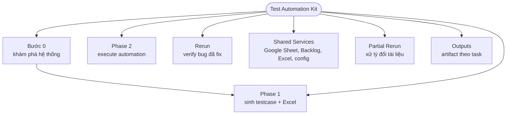

# Test Automation Kit

> Phân tích requirement, sinh testcase, execute automation, triage bug và quản lý evidence theo một
> quy trình có máy gác ở từng cửa.

## Đọc một trang này trước

**[`docs/CHEATSHEET.md`](docs/CHEATSHEET.md)** là thứ duy nhất cần đọc trước khi chạy: năm lệnh, ba cửa
ra, cách đọc output của `npm run check`, và cách xin vượt qua cho hợp lệ.

**Đường ngắn nhất, năm lệnh phải thuộc:**

```
/start  →  /phase1  →  /phase2  →  /rerun  →  /release
```

Đây là **rút gọn** của luồng đầy đủ chín bước (xem mục [13 slash command](#13-slash-command)): bốn lệnh
bị lược đi là `/discover`, `/preflight`, `/gates` và `/publish`. Chúng không cần thuộc vì
`npm run check` gợi ý đúng lúc ở dòng **Lệnh tiếp theo**, hoặc xem thẳng bằng
`npm run next -- --task <TASK_KEY>`.

## Đi đâu tiếp

| Bạn cần | Đọc |
|---|---|
| Dựng kit trên máy mới | [`QUICKSTART.md`](QUICKSTART.md) |
| Chạy một task từ đầu đến cuối | [`USER_GUIDE.md`](USER_GUIDE.md) |
| Biết một thư mục dùng để làm gì | [`docs/kit-map.md`](docs/kit-map.md) |
| Tra luật | [`RULE_GLOBAL.md`](RULE_GLOBAL.md) — bản rút gọn luôn trong ngữ cảnh agent: [`CLAUDE.md`](CLAUDE.md) |
| Hiểu **vì sao** một luật tồn tại | [`docs/rationale/`](docs/rationale/) |
| Nâng bản kit | [`docs/UPGRADE.md`](docs/UPGRADE.md) và [`CHANGELOG.md`](CHANGELOG.md) |
| Học sâu — tài liệu đào tạo, không cần đọc để dùng kit | `docs/course/` và `docs/library/` |

## Giới hạn — đọc trước khi chọn kit này

Nói thẳng ở đây rẻ hơn nhiều so với để bạn phát hiện sau khi đã dựng xong profile và viết được nửa bộ
case.

- **Chỉ Playwright.** Không Selenium, không Appium, không lớp mobile-native. Mobile chỉ tới mức
  **mobile-web** (giả lập thiết bị trong cùng một browser). Dự án cần mobile-native thì cần kit khác.
- **Test management là Google Sheet**, công cụ duy nhất. Bug đi Backlog. Không có tầng tích hợp nào khác.
- **DB chỉ đọc**, và chỉ qua client riêng của kit. Tiền điều kiện không được dựng bằng DB.
- **Captcha không tự giải được.** Màn login của app hiện tại sinh captcha mới mỗi postback, nên **CI
  không người trông sẽ không tự đăng nhập được**. Phải nạp sẵn phiên, hoặc có người đọc captcha.

## Kiến trúc



| Lớp | Làm gì |
|---|---|
| **Bước 0** | Bò app bằng script tất định, trả bản đồ màn, danh mục API, vùng mù tài liệu. Mẫu số coverage của Phase 1 lấy từ đây, nên màn không có trong tài liệu vẫn vào phạm vi. Mọi bản ghi là `observed`, không phải oracle |
| **Phase 1** | Đọc requirement, sinh testcase Markdown canonical, xuất Excel, chấm coverage |
| **Publish** | Sau khi QA duyệt, đẩy Excel lên Google Sheet qua Drive MCP |
| **Phase 2** | Dựng tiền điều kiện qua setup layer, execute Playwright, thu evidence, đồng bộ cột `Result` |
| **Rerun** | Chạy lại case của bug đã fix. Không dùng để đồng bộ tài liệu mới |
| **Partial Rerun** | Nhánh phụ xử lý tài liệu đổi. Xoá nhánh này thì luồng chính vẫn chạy |
| **Setup Layer** | `tests/support/setup/`: factory, hook, fixture, mock, cleanup, contract. Không dựng state bằng DB |

## Cấu trúc thư mục

```text
test-automation-kit/
├── .claude/
│   └── commands/            13 slash command — điểm vào chuẩn hoá (bảng ngay dưới)
│                            chỉ commands/ được commit; settings*.json là cấu hình máy cá nhân
├── .agent/
│   ├── config/              verdict_taxonomy · risk_model · case_types · ci_scope · branch_parity
│   │                        GATES.md (danh mục 151 máy gác, tự sinh)
│   │                        db.conventions.json  quy ước DB + bản đồ cột ↔ nhãn theo màn
│   │                        locators.schema.json schema cho knowledge/locators/
│   ├── workflows/           phase1_* · phase2_* · rerun_* — mỗi flow 1 file entry + các bước
│   ├── skills/              26 skill theo vai trò; INDEX.md là danh mục (tự sinh)
│   └── rules/               core_rules · playwright_fe · playwright_api · locator
├── prompt_templates/
│   ├── run_phase1_template.md      điểm vào Phase 1
│   ├── run_phase2_template.md      điểm vào Phase 2
│   ├── run_phase_re-run_template.md
│   ├── phase1/              01 chuẩn bị → 02 sinh testcase → 02b định dạng → 03 test data → 04 publish
│   │   └── dimensions/      22 chương CHIỀU coverage — mở đúng chiều task cần, không nạp cả bộ
│   └── phase2/              04 execute FE → 05 execute API → 06 triage → 07 flaky → 08 log bug
├── partial-rerun/           nhánh phụ khi requirement đổi: prepare review → apply approved
├── exploratory/             nhánh phụ never-auto, phiên dò rủi ro có charter
├── manual-run/              nhánh phụ never-auto, chạy tay case khai [manual]
├── scripts/
│   ├── qa/                  máy gác chạy thật: preflight · output_gate · design_gate · risk ·
│   │                        accessibility · perf · security · load · ui_conformance · dashboard
│   ├── convert_excel/       Markdown canonical ↔ Excel, ghi cột Result
│   ├── integrations/        backlog/ (bug + fetch tài liệu) · google_doc/ · google_sheet/ (legacy)
│   ├── lib/ · utils/        hàm dùng chung, runtime_config, evidence_recorder
│   └── ci/                  khai biến CI
├── tests/
│   ├── fe/infra/            172 spec KIỂM CHÍNH KIT — chạy offline, vào CI
│   ├── fe/lib/ · pages/     thư viện bước và page object dùng chung
│   ├── support/setup/       setup layer: factory · hook · fixture · mock · cleanup · contract
│   │   └── db/              DB Verification Layer, read-only tuyệt đối, chỉ để khoanh tầng lỗi
│   ├── mobile-web/          spec mobile-web (giả lập thiết bị)
│   ├── load/                script k6 (opt-in)
│   └── fixtures/            dữ liệu mẫu cho spec tự kiểm
├── knowledge/               bộ nhớ học: bugs · domain · system · decisions · locators · metrics
│                            KHÔNG commit (dữ liệu công ty). Repo chỉ giữ SCHEMA.md
├── profiles/
│   └── <TASK_KEY>/task.env  env động theo task. KHÔNG commit (creds); chỉ task.env.example
├── outputs/
│   └── <PROJECT>/tasks/<TASK_KEY>/   artifact theo task. KHÔNG commit
├── requirements/            scope inventory và neo mẫu số
├── docs/
│   ├── CHEATSHEET.md        một trang để chạy
│   ├── kit-map.md           bản đồ kit đầy đủ, chú thích từng file
│   ├── rationale/           VÌ SAO từng luật tồn tại, kèm số đo
│   ├── user-guide-images/   sơ đồ của USER_GUIDE (sinh bằng script)
│   ├── course/ · library/   tài liệu đào tạo, không cần đọc để dùng kit
│   └── UPGRADE.md           nâng bản kit
├── vendor/                  gói nhúng sẵn, để `npm ci` không cần mạng ngoài
├── .github/ · .gitlab-ci.yml   CI: static-check mỗi push; job chạm UAT là manual
├── README.md · QUICKSTART.md · USER_GUIDE.md · CHANGELOG.md
├── CLAUDE.md                luật rút gọn, luôn trong ngữ cảnh agent
└── RULE_GLOBAL.md           luật canonical
```

Chú thích từng file: [`docs/kit-map.md`](docs/kit-map.md).
Quy ước Playwright: [`.agent/rules/playwright_fe.md`](.agent/rules/playwright_fe.md).

## 13 slash command

Mỗi lệnh là một **điểm vào chuẩn hoá**: nó trỏ tới workflow và prompt thật, liệt kê gate phải qua, rồi
dừng lại đúng chỗ cần người quyết. Lệnh không chứa luật, nên sửa luật thì sửa ở `RULE_GLOBAL.md`.

Gõ trong Claude Code. Phần sau tên lệnh phải đúng bằng `<TASK_KEY>`, không thêm chữ nào.

### Luồng chính, theo đúng thứ tự chạy

```text
/start → /discover → /preflight → /phase1 → /gates → /publish → /phase2 → /rerun → /release
```

**1. `/start <TASK_KEY>`: mở một task mới**

Cửa vào khi bạn chưa có gì cả. Nó hỏi đúng 5 điều (task nào, module nào, nguồn requirement ở đâu,
môi trường nào, giới hạn scope), tạo `profiles/<TASK_KEY>/task.env`, chạy preflight, rồi chỉ lệnh kế
tiếp. Thiếu câu trả lời nào thì nó **dừng và hỏi**, không tự điền.

**2. `/discover`: xem hệ thống có những gì**

Bò app bằng script tất định rồi trả về bản đồ màn, danh mục API, vùng mù tài liệu và bề mặt injection.
Dùng khi mở một hệ thống hoặc module mà **chưa biết nó có gì**. Mẫu số coverage của Phase 1 lấy từ
đây, nên màn nào tài liệu không nhắc vẫn vào phạm vi. Mọi bản ghi là `observed`, tức quan sát được,
**không phải** kết luận đúng sai.

**3. `/preflight <TASK_KEY>`: kiểm trước khi vào phase**

Soát input và config bắt buộc: thiếu file, JSON hỏng, hoặc chưa có testcase canonical thì **chặn**.
Mục đích là hỏng sớm ở cửa vào, thay vì hỏng giữa chừng khi đã chạy được nửa bộ case. Gặp exit khác 0
thì sửa nguyên nhân, đừng bỏ qua.

**4. `/phase1 <TASK_KEY>`: sinh bộ testcase**

Đọc spec, hỏi cho hết chỗ mơ hồ, rồi mới sinh Markdown canonical và xuất Excel. Phase này **không
execute** gì cả.

Chỗ dừng quan trọng là **Ambiguity Gate**: requirement còn mơ hồ ở mức Critical hoặc High thì nó ghi
câu hỏi ra `reports/phase1-clarifications.md` và **chờ bạn trả lời**, không đoán rồi sinh bừa.

**5. `/gates <TASK_KEY>`: soát lại trước khi chốt**

Chạy một bó gate gộp: preflight, thiết kế case, chất lượng từng dòng, kết quả execute, phần cam kết.
Dùng trước khi finalize hoặc publish. Còn dòng CHẶN thì **sửa nội dung cho đúng**, không nới ngưỡng
để cho qua.

**6. `/publish <TASK_KEY>`: đẩy lên Google Sheet**

Đồng bộ testcase hoặc kết quả execute lên Sheet. Nó luôn cho bạn **xem bản local trước**, chỉ ghi đè
Sheet thật sau khi bạn duyệt. Chạy sau khi QA đã xác nhận bộ case ở bước 5.

**7. `/phase2 <TASK_KEY>`: chạy thật**

Dựng automation, execute trên môi trường test, chấm verdict theo taxonomy chuẩn. Nó **xác nhận với
bạn trước lượt chạm UAT đầu tiên**, vì UAT là môi trường dùng chung.

Fail ở bước dựng tiền điều kiện được tính là `setup_failure`, **không phải** lỗi sản phẩm, nên không
log bug.

**8. `/rerun <TASK_KEY>`: kiểm lại sau khi Dev fix**

Chạy lại đúng những case liên quan tới bug đã fix rồi cập nhật kết quả. Nó **không sinh testcase
mới** — requirement đổi là việc của `/partial-rerun`.

**9. `/release <TASK_KEY>`: cửa cuối**

Chạy cửa ra `done` rồi đưa khuyến nghị go hoặc no-go **có căn cứ**, không phải cảm tính. Dùng khi đã
execute xong và sổ nợ đã sạch; còn nợ thì nó không cho qua.

### Bốn nhánh phụ, gọi khi gặp đúng tình huống

Không nằm trong luồng chính. Xoá chúng đi thì luồng chính vẫn chạy bình thường.

**`/partial-rerun <TASK_KEY>`: requirement đổi giữa chừng**

Khi BA, UIUX hoặc BE sửa tài liệu **sau khi** đã có testcase. Nó dựng bản review trước (diff, phần bị
ảnh hưởng, case draft), và **chỉ merge sau khi bạn duyệt**. Chưa có testcase baseline thì dùng
`/phase1` chứ không dùng lệnh này.

**`/manual-run <TASK_KEY>`: case không tự động hoá được**

Chạy tay những case khai `[manual]` để chúng có verdict thật, thay vì nằm mãi ở `SKIP_SETUP` — mà
`SKIP_SETUP` chỉ là lời khai "chưa chạy", không phải kết luận.

Case **chưa** khai `[manual]` thì lệnh **dừng**. Đây không phải đường lách automation.

**`/explore <phạm vi>`: dò rủi ro ngoài bộ case**

Mở một phiên exploratory có charter, tìm rủi ro nghiệp vụ mà bộ case đã viết không chạm tới. Chưa khai
charter thì không chạy, vì dò không mục tiêu thì không kết luận được gì.

**`/ui-debug <màn>`: màn mới hoặc locator hỏng**

Khám phá DOM thật để tìm locator bền và neo nhãn UI với cột DB. Dùng khi gặp màn mới, hoặc khi test
đỏ vì `script_error` do locator. Đây là lệnh **never-auto**: nó mở browser vào UAT nên luôn phải xác
nhận trước.

---

Không cần thuộc thứ tự: `npm run check` cho biết lệnh kế tiếp nên chạy, bất cứ lúc nào.
Quên mã task thì `npm run task:which` in danh sách profile đang có để chọn, và **không tự đoán**.


## Máy gác

Kit không dựa vào việc người nhớ luật. Mỗi luật đo được đều có một máy gác, và CI chạy chúng mỗi lần
push.

```bash
npm run preflight -- --task <TASK_KEY>   # thiếu input hoặc config hỏng thì chặn
npm run gates -- --task <TASK_KEY>       # bó gate trước khi finalize
npm run next -- --task <TASK_KEY>        # lệnh tiếp theo nên chạy
```

Danh mục đầy đủ (tự sinh, đừng sửa tay): [`.agent/config/GATES.md`](.agent/config/GATES.md).

Quy ước mã thoát: **1 = đã đo và sai**, **2 = chưa phán được**. Gặp exit 2 thì đừng đọc report của
lượt đó.

## Phát hành kit

Dành cho người maintain kit, không phải người dùng.

```bash
npm run version:check    # version hợp semver, khớp tag, CHANGELOG có mục tương ứng
npm run package:kit      # đóng gói CHỈ lớp GENERIC ra dist/
npm run release:verify   # cổng cuối: giải nén ra thư mục sạch rồi chạy lại toàn bộ
```

`release:verify` là **cổng**: không đạt thì không phát hành. Ranh giới GENERIC và PROJECT:
[`.agent/config/kit-layers.md`](.agent/config/kit-layers.md).
