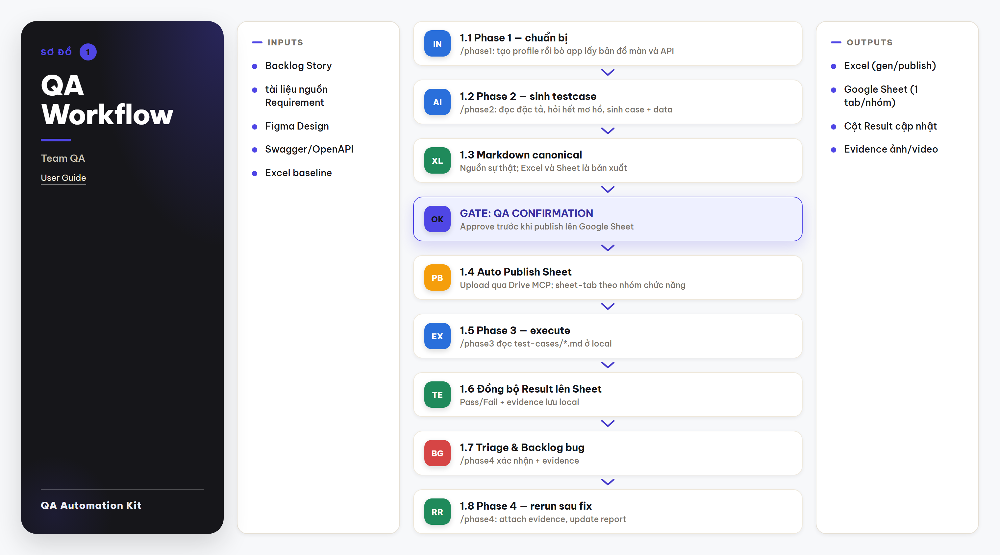
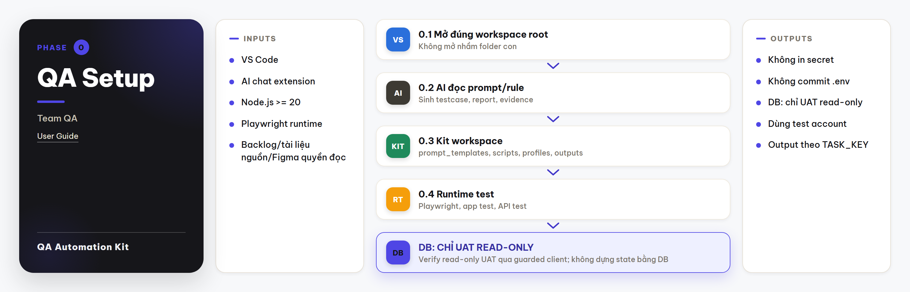
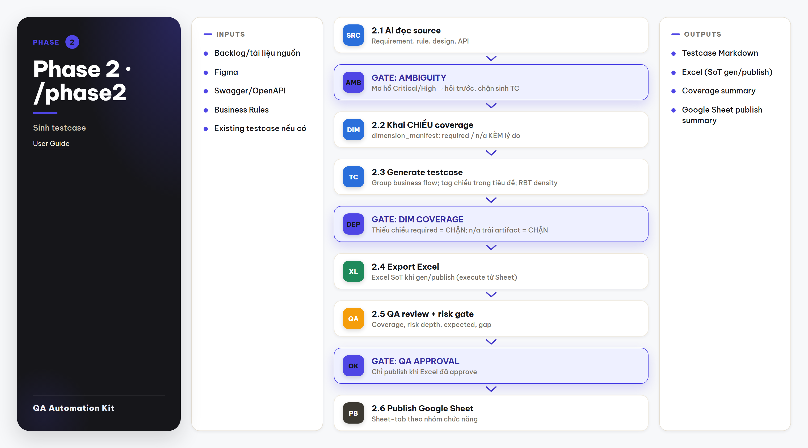
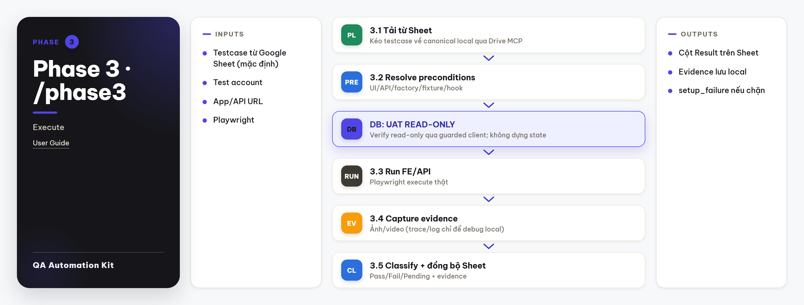
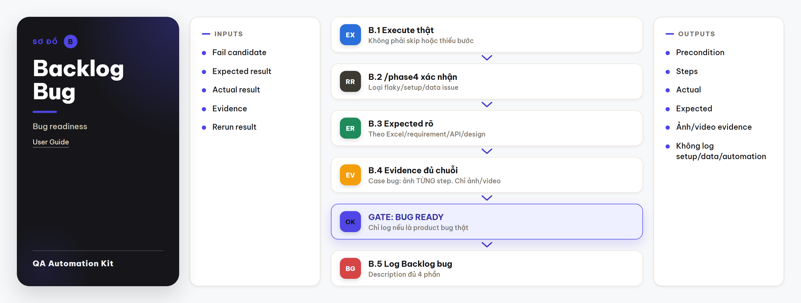
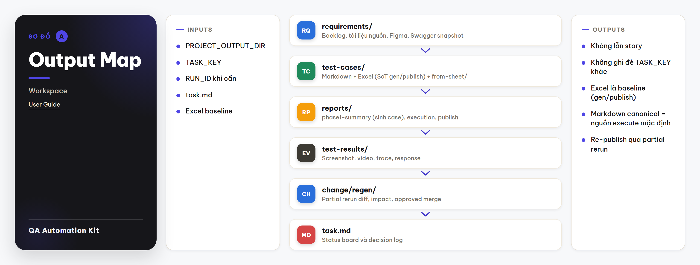
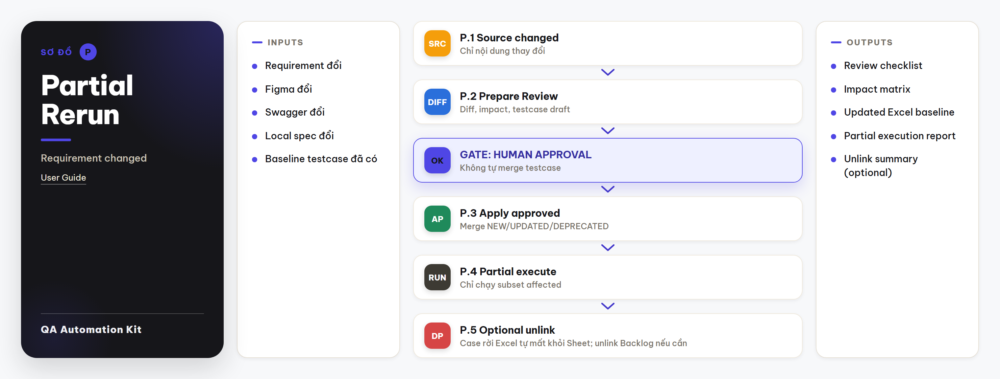
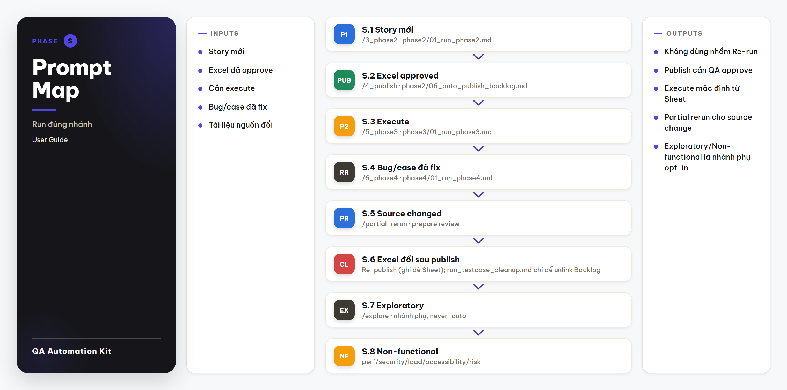
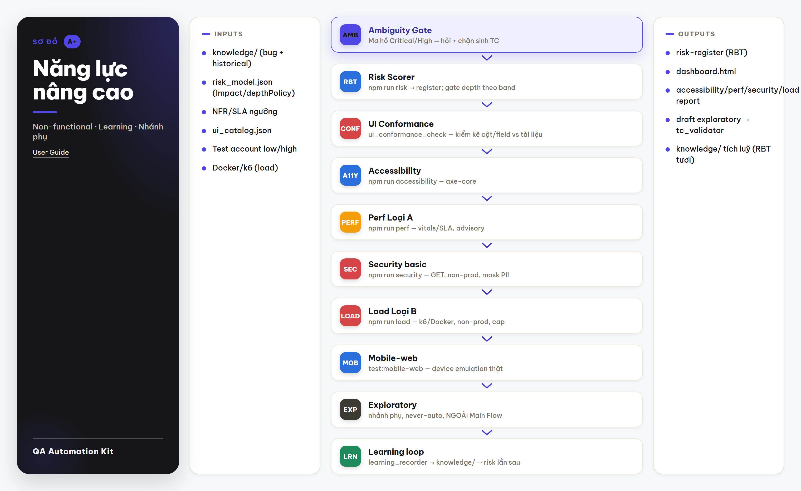

# Hướng dẫn sử dụng Test Automation Kit

> Dành cho **QA Member**, **QA Lead** và **Automation Engineer**. Tài liệu này nói **làm gì** và **chạy
> lệnh nào**. Phần **vì sao một luật tồn tại** nằm ở [`docs/rationale/`](docs/rationale/) — mỗi chỗ cần
> đều có một dòng link.

| Bạn là | Đọc mục |
|---|---|
| Lần đầu dùng kit | [QUICKSTART.md](QUICKSTART.md) → rồi mục 2, 3 ở đây |
| QA Member chạy một task | 3 · 4 · 8 · 9 |
| QA Lead review kết quả | 6 · phụ lục 11.2 |
| Automation Engineer | 2 · 4 · 7 · 8 · 10 |

---

## 1. Kit làm gì



Kit chạy theo **bốn phase**, và bạn gọi từng phase bằng một slash command. Thứ tự chạy nằm ở bảng
dưới đây — tên lệnh không mang số, vì trong Claude Code tên file chính là tên lệnh.

```text
/phase1  →  /phase2  →  [/publish]  →  /phase3  →  /phase4  →  /release
 chuẩn bị     sinh case      đẩy Sheet        execute       rerun         cửa ra
```

| Phase | Lệnh | Làm gì | Ai quyết định |
|---|---|---|---|
| **1** | `/phase1` | Tạo profile task, rồi bò app bằng script để lấy mẫu số từ thứ **quan sát được** chứ không chỉ từ tài liệu | — |
| **2** | `/phase2` | Đọc đặc tả, hỏi hết mơ hồ, sinh testcase, xuất Excel | QA review trước khi sang phase 3 |
| **3** | `/phase3` | Execute thật trên môi trường test, chấm verdict | QA duyệt trước khi ghi lên Sheet |
| **4** | `/phase4` | Chạy lại case của bug đã fix | QA |

Ba lệnh nữa nằm trong dòng chảy nhưng **không phải một phase**: `/start` (bước đầu nằm trong phase
1), `/publish` (đẩy Sheet, chen giữa phase 2 và 3) và `/release` (cửa cuối sau phase 4).

Bảy lệnh còn lại là **công cụ**: gọi khi gặp đúng tình huống, không có vị trí cố định trong dòng
chảy — `/discover`, `/preflight`, `/gates`, `/partial-rerun`, `/manual-run`, `/explore`, `/ui-debug`.

**Kit không thay QA quyết định.** Agent đọc tài liệu, sinh case, chạy test và tổng hợp. Coverage đủ
chưa, risk chấp nhận được không, bug có đáng log không — vẫn là người quyết.

### Bảy luật không được vi phạm

| Luật | Vi phạm thì sao |
|---|---|
| Đúng `TASK_KEY` | Ghi đè output của task khác |
| Bộ case của `/phase2` phải được review trước khi `/phase3` chạy | Execute theo expected sai |
| `test-cases/*.md` là nguồn sự thật, Excel và Sheet là bản xuất | Sửa trên Sheet sẽ mất ở lần đồng bộ sau |
| Không skip để làm đẹp pass rate | Report không phản ánh chất lượng thật |
| Không log bug khi fail do setup/data/automation | Tạo nhiễu cho Dev |
| Không đổi expected khi chưa có nguồn xác nhận | Biến bug thật thành pass ảo |
| Evidence phải là ảnh hoặc video | QA Lead và Dev không kiểm chứng được |

Luật đầy đủ: [`RULE_GLOBAL.md`](RULE_GLOBAL.md). Bản rút gọn luôn trong ngữ cảnh agent:
[`CLAUDE.md`](CLAUDE.md).

---

## 2. Chuẩn bị: làm một lần



### 2.1 Cài đặt

Dựng lần đầu thì theo [`QUICKSTART.md`](QUICKSTART.md) — ở đó có đủ mười bước, gồm cả mấy file config
mà thiếu là `preflight` chặn. Mục này chỉ nhắc phần chạy hằng ngày:

```bash
git pull
npm ci                        # theo lockfile, KHÔNG dùng npm install
npx playwright install
npm run integration:check     # kiểm kết nối, không bắt buộc
```

| Cần | Ai cần | Để làm gì |
|---|---|---|
| VS Code + AI chat extension | tất cả | Nơi làm việc với agent |
| Node.js ≥ 20 | QA, Automation | Chạy script và Playwright |
| Playwright runtime | QA, Automation | Execute và tạo evidence |
| Quyền Backlog / tài liệu / Figma | QA, QA Lead | Đọc requirement |
| Credential app test | QA, Automation | Login, gọi API, dựng data |
| k6 hoặc Docker | Automation | Chỉ khi chạy load test (mục 10) |

QA Lead chỉ review report thì không cần cài Playwright.

### 2.2 Profile cho từng task

Mỗi task một profile riêng. Đây là cơ chế giữ các task không đè lên nhau.

Cách thường dùng là `/start <TASK_KEY>`: nó hỏi 5 điều rồi tạo profile cho bạn. Muốn tạo thẳng không
qua hỏi đáp thì:

```bash
npm run profile:create -- <TASK_KEY> --project-output outputs/<PROJECT>
```

Rồi mở `profiles/<TASK_KEY>/task.env` điền **giá trị động**: link Backlog, link requirement, Figma,
`GOOGLE_SHEET_URL`, tài khoản app.

| Loại giá trị | Ví dụ | Đặt ở |
|---|---|---|
| **Tĩnh**: một tài khoản dùng cho mọi task | API key Figma, `BACKLOG_BASE_URL`, `BACKLOG_API_KEY` | `.env` chung |
| **Động**: theo task | `TASK_KEY`, link story, `GOOGLE_SHEET_URL` | `profiles/<TASK_KEY>/task.env` |
| **Đơn vị đang đo**: theo task | `APP_SO`, `APP_CAP_HOC`, `APP_TRUONG`, `APP_NAM_HOC`, `LIB_MASTER_DB_RO_*` | `profiles/<TASK_KEY>/task.env` |

**Mỗi profile PHẢI ghim mọi biến chọn ngữ cảnh mà app mặc định ngầm.** Biến nào là dữ liệu của dự án,
khai ở `.agent/config/context_pins.json` (mẫu: `context_pins.example.json`), gác bằng `npm run env:scope` và
preflight phase2. Chưa khai file đó thì luật không áp; profile không có khoá nào khớp `nhan_dien` (task của
app khác) cũng không bị đòi.

Vì sao phải chặn: thiếu biến đó thì app lặng lẽ về ngữ cảnh mặc định, và chỗ nguy là nó chỉ `console.warn`.
Lượt chạy không gãy: nó đăng nhập được, đi hết các bước, chụp đủ ảnh, rồi chấm **PASS** trên một ngữ cảnh
**không phải** ngữ cảnh mà case nói tới. Không ca nào đỏ. Biến "nên ghim" (khai ở `nen_ghim`) chỉ cảnh báo.

Ngược lại, `.env` chung giữ **một** tài khoản app cho mọi task là **đúng thiết kế**, không phải lệch: một
tài khoản app mẫu đổi được Sở, cấp và trường qua `/Manage/ChonDonVi.aspx`, nên thứ phân biệt các task là
khối `APP_*` trong profile, chứ không phải mỗi task một mật khẩu riêng.

> Lịch sử của chính đoạn này, để lần sau đừng sửa qua sửa lại. Bảng từng xếp `OPS_*` vào cột "Tĩnh".
> Bản sửa đầu 03/11/2026 đổi thành *"`OPS_*` KHÔNG được để ở `.env` chung"*, và đó cũng **sai**: luật ấy
> tố oan **7 trong 8** profile, vì `profiles/task.env.example` không hề có `OPS_*`. Ràng buộc thật nằm ở
> chỗ profile có ghim nổi **cấp học** hay không. Nguồn chốt: [`RULE_GLOBAL.md`](RULE_GLOBAL.md) §Đường
> dẫn chuẩn, `knowledge/setup_recipes/SR-APPMAULOGIN-001.json`, và `opsLogin.ts:419`.

**Không sửa `.env` chung khi task khác đang chạy.**

### 2.3 MCP server: tuỳ chọn

MCP giúp agent đọc Figma và Google Drive trực tiếp. Không có MCP thì vẫn chạy được bằng file export.
Template: [`.agent/config/mcp_config.md`](.agent/config/mcp_config.md).

Chỉ trỏ MCP vào môi trường test. Token để trong `.env` local, không commit, không dán vào chat.

---

## 3. Chạy một task

Mỗi phase đều cùng một hình dạng: **chạy gì, ra gì, kiểm gì**.

Trong tài liệu này `TASK_DIR` viết tắt cho `<PROJECT_OUTPUT_DIR>/tasks/<TASK_KEY>/`.

### 3.1 `/phase1` — chuẩn bị: profile và khám phá

**Chạy:**

```text
/phase1 <TASK_KEY>
```

Nó làm **đúng hai việc, theo thứ tự**: `/start` tạo `profiles/<TASK_KEY>/task.env` rồi `/discover`
bò app. Gọi riêng từng bước cũng được — dùng khi cần chạy lại một trong hai.

Bước khám phá chạm UAT, nên nó **xác nhận với bạn trước**, và chỉ ĐỌC. Không có agent thì chạy tay:

```bash
npm run discover
```

Trước khi chạy, trả lời được năm câu: task nào, module nào, phase nào, nguồn requirement ở đâu ·
có giới hạn scope không.

**Ra gì:** `TASK_DIR/requirements/system_map.json` — mẫu số coverage của phase 2 lấy từ đây, nên màn
nào tài liệu không nhắc vẫn vào phạm vi. Mọi bản ghi là `observed` (quan sát được), **không phải**
kết luận đúng sai, nên nó **không dùng làm oracle**.

Phase 1 **không đọc đặc tả và không sinh case**. Nó dừng sau khi báo bản đồ.

Agent phải echo lại scope trước khi ghi file:

```text
PROJECT_OUTPUT_DIR=…  TASK_KEY=…  TASK_OUTPUT_DIR=…  Phase=…
```

`TASK_KEY` không khớp thì **dừng ngay**.

### 3.2 `/phase2` — sinh testcase

**Chạy:**

```text
/phase2 <TASK_KEY>
```

Hoặc trỏ thẳng vào `prompt_templates/phase2/01_run_phase2.md`.

**Trước đó, soát tài liệu nguồn:**

```bash
npm run docs:index -- --task <TASK_KEY>
npm run docs:cite  -- --task <TASK_KEY> BR-07
```

Nó bắt bốn lỗi im lặng: **LỆCH BẢN**, **RỖNG**, **MẤT BẢNG**, **CÒN ENTITY**. Gặp cái nào thì fetch
lại trước khi sinh case.
Vì sao đáng soát: [`docs/rationale/tai-lieu-nguon.md`](docs/rationale/tai-lieu-nguon.md)

**Khai chiều coverage trước khi gen:**

```bash
npm run dim:coverage              # lấy khung manifest
npm run dim:coverage -- --enforce # kiểm trước khi đưa QA duyệt
```

Mỗi chiều khai `required` hoặc `n/a` **kèm lý do** trong `requirements/dimension_manifest.json`. Chiều
`required` thì mở đúng chương tương ứng ở [`prompt_templates/phase2/dimensions/`](prompt_templates/phase2/dimensions/)
— không nạp cả bộ.
Vì sao có trục thứ hai: [`docs/rationale/chieu-coverage.md`](docs/rationale/chieu-coverage.md)

**Ra gì:**

| Output | Nằm ở |
|---|---|
| Requirement artifact | `TASK_DIR/requirements/` |
| Testcase canonical | `TASK_DIR/test-cases/*.md` (bản xuất `*.xlsx`) |
| Báo cáo sinh case (mở đầu bằng mục `Test Plan`) | `TASK_DIR/reports/phase1-summary.md` |
| Tiêu chí exit, chờ PM xác nhận | `TASK_DIR/reports/exit_criteria.json` |
| Yêu cầu hook cho Dev | `TASK_DIR/reports/capability-request.md` |
| Nhật ký task | `TASK_DIR/task.md` |

**Case đạt yêu cầu cần có:** trace về requirement, tiền điều kiện, test data, step chạy được ·
expected cụ thể theo business rule, biết assert cái gì, có priority và severity, thuộc một nhóm
chức năng.

Mỗi ô `Tiền điều kiện` phải mang tag `[<method>]` — `api`, `factory`, `test_hook`, `ui`,
`pre_existing`, `manual`. **Không có `db`**: dựng state bằng DB là bỏ qua business logic.

**Mục `Test Plan` ở đầu `phase1-summary.md`** gom năm câu người review hỏi trước tiên: không test gì
(Not in Scope), đang giả định gì (Assumptions), khi nào được execute (Entry), khi nào là xong (Exit), và
rủi ro dự án nào đang mở. Mỗi dòng trỏ về nguồn, không chép lại.

**Tiêu chí exit chốt ngay ở phase này**, không đợi tới lúc release: `npm run release:summary:init -- --task <TASK_KEY>`,
sửa ngưỡng theo dự án, rồi để **PM xác nhận trước lượt execute đầu tiên**. Sửa file tiêu chí sau khi đã
có kết quả thì `release:summary` từ chối, vì nhìn số rồi mới đặt ngưỡng là hợp thức hoá kết quả.

`/phase2` **không execute**. Nó dừng ở `Pending QA confirmation`.

### 3.3 Review bộ case: cửa quyết định



Mở: `task.md`, `reports/phase1-summary.md`, `test-cases/*.md`

| Kiểm | Ngưỡng |
|---|---|
| Requirement coverage | ≥ 80% |
| Core / high-risk flow | Phải cover đủ |
| Gap Critical/High | Không còn mở, hoặc có người chấp nhận risk rõ ràng |
| Negative case | Cover nếu nằm trong scope |
| Setup Readiness | Mỗi precondition có tag `[<method>]` khả thi |

Chạy máy gác thay vì đọc tay:

```bash
npm run preflight -- --task <TASK_KEY>
npm run self-review:enforce -- --task <TASK_KEY>
```

**Kết luận hợp lệ:** `PASS`, `CONDITIONAL PASS`, `FAIL`, `BLOCKED`.

Coverage cao mà còn gap Critical/High thì **không PASS**.

**Publish lên Google Sheet** sau khi QA duyệt:

```text
/publish <TASK_KEY>
```

### 3.4 `/phase3` — execute



**Chạy:**

```text
/phase3 <TASK_KEY>
```

Agent **xác nhận với bạn** trước lượt chạm môi trường test đầu tiên.

**Smoke gate chạy trước spec đầu tiên** (`npm run smoke:gate -- --task <TASK_KEY>`). Nó mở từng màn trong
`requirements/ui_catalog.json`, chỉ đọc, và phân biệt hai kiểu "đỏ" trái ngược nhau:

| Smoke thấy | Kết luận | Làm gì |
|---|---|---|
| Mọi màn mở được, đủ control | `SACH` | chạy bộ case |
| Một số màn lệch locator, URL cũ, hoặc 5xx riêng một màn | `CHAY_TIEP_CO_CANH_BAO` | chạy tiếp; soi màn đó bằng `/ui-debug` trước khi tin FAIL của nó |
| **Mọi** màn không mở được | `DUNG` · tầng `infra` | không chạy bộ case, không log bug, báo người phụ trách môi trường |
| Bị đẩy về trang đăng nhập | `DUNG` · tầng `setup_failure` | sửa phiên đăng nhập rồi chạy lại |
| Thiếu catalog hoặc URL gốc | `KHONG_KIEM_DUOC` | **không phải xanh** — ghi vào báo cáo rằng lượt này chạy không có smoke gate |

**Ra gì:**

| Output | Nằm ở |
|---|---|
| Kết quả smoke gate | `TASK_DIR/reports/smoke-gate.md` |
| Kết quả Playwright | `TASK_DIR/test-results/` |
| Evidence | `TASK_DIR/test-results/artifacts/` |
| Báo cáo execute | `TASK_DIR/reports/execution-summary.md` |
| Verdict máy đọc | `TASK_DIR/test-results/testcase-status.json` |

**Luật khi execute:**

| Chủ đề | Luật |
|---|---|
| Nguồn case | Đọc `test-cases/*.md`. `from-sheet/` chỉ dùng cho gate chống lệch |
| Tiền điều kiện | Dựng theo tag `[<method>]` qua setup layer — **không bằng DB** |
| Skip | Hạn chế tối đa, mỗi skip phải có lý do và cách fix |
| Fail | Phải phân loại root cause (mục 3.5) |
| Evidence | Ảnh/video ở **bước quyết định** mỗi case; case thành bug thì **từng step** |
| Assertion | Không xoá assertion để tăng pass rate |

Fail ở bước dựng tiền điều kiện là `setup_failure`, **không phải** product bug.

**Đồng bộ kết quả lên Sheet** — mặc định `PUSH_EXECUTION=confirm`: ghi vào `.xlsx` local trước, QA xem
preview, duyệt rồi mới đẩy lên Sheet thật.
Mô hình Sheet và vì sao chọn nó: [`docs/rationale/google-sheet.md`](docs/rationale/google-sheet.md)

### 3.5 Triage fail và skip

| Loại | Dấu hiệu | Làm gì |
|---|---|---|
| Product bug | App/API sai expected thật | `/phase4` xác nhận rồi chuẩn bị log |
| Automation issue | Locator/script/assertion sai | Sửa rồi chạy lại |
| Test data issue | Dữ liệu thiếu hoặc không rollback được | Dựng qua API/factory/hook; không dựng bằng DB |
| Environment issue | App/API/auth lỗi | Ghi blocker, **không** log product bug |
| Flaky | Lúc pass lúc fail | Rerun nhiều vòng rồi mới kết luận |
| Requirement unclear | Expected chưa đủ rõ | Hỏi BA/BE, **không** tự đổi expected |

### 3.6 Log bug Backlog



**Sáu điều kiện, thiếu một là chưa log:**

1. Case đã execute thật, không phải skip
2. Đã re-run 2–3 lần để loại flaky và setup
3. Expected có nguồn xác nhận (testcase / requirement / API / design)
4. Actual rõ ràng, có log hoặc response
5. Đã loại trừ nguyên nhân không phải sản phẩm
6. Evidence là ảnh hoặc video — **không** dùng `.md`, `.json`, `.log`

**Mô tả bug đúng bốn phần:** tiền điều kiện, bước tái hiện, kết quả hiện tại, kết quả mong muốn.

Trước khi log, tra sổ quyết định cũ:

```bash
node scripts/qa/decisions.js --check "<triệu chứng>" --module <Module>
```

Khớp `false_positive` hoặc `by_design` thì **không log lại** — log lại là bị Dev bounce lần hai.

### 3.7 `/phase4` — rerun sau khi Dev fix

```text
/phase4 <TASK_KEY>
```

`/phase4` chỉ xử lý bug hoặc case fail đã có. **Không** dùng nó để cập nhật testcase theo tài liệu
mới — việc đó là Partial Rerun (mục 5).

PASS thật thì: đính evidence, comment Backlog kèm TC ID, chuyển bug sang `Done`, cập nhật report.
Vẫn FAIL thì giữ bug mở và ghi lý do.

### 3.8 `/release` — cửa cuối

```text
/release <TASK_KEY>
```

Chạy cửa ra `done` (chặn khi sổ nợ gate còn món), rồi `release:summary` đối chiếu kết quả với
`reports/exit_criteria.json` và đưa **khuyến nghị** — quyết định phát hành là của PM/PO:

| Khuyến nghị | Khi nào |
|---|---|
| `GO` | mọi tiêu chí đo được đều đạt, không có case chưa chạy |
| `CONCERNS` | có tiêu chí **không đạt** nhưng PO đã chấp nhận kèm cách giảm thiểu và hạn; báo cáo nêu từng cái |
| `NO-GO` | còn tiêu chí không đạt chưa ai chấp nhận, tiêu chí **không đo được**, hoặc case chưa từng chạy |

**PO chấp nhận một tiêu chí không đạt** thì ghi quyết định `release_exception` vào `knowledge/decisions/`
(skill `decision_recorder`): bắt buộc `decided_by: PO`, `task_key`, `exit_criterion_id`, `mitigation` và
`expires_at`. Thiếu ô nào là bị chặn. Không ghi vào `exit_criteria.json`. Ngoại lệ không áp cho tiêu chí
không đo được: chấp nhận một thứ chưa ai đo là biến "không phán được" thành đạt.

**Rủi ro dự án** (môi trường, phụ thuộc, dữ liệu, tiến độ) nằm ở sổ `knowledge/risks/`, in ra cạnh khuyến
nghị. Mỗi rủi ro có người chịu, cách giảm thiểu và hạn; quá hạn thì lên đầu danh sách.

```bash
npm run risks:new -- --title "<tiêu đề>"   # máy cấp RISK-<NNN>, rồi điền mọi ô <ĐIỀN>
npm run risks -- --task <TASK_KEY>         # rủi ro đang mở của task
```

Risk ID không bao giờ được cấp lại. Rủi ro chỉ được **đóng** (`status: closed` kèm lý do), không được
xoá; xoá file là bị chặn. Sổ này khác `risk-register` của `npm run risk`, vốn chấm rủi ro theo module để
chia độ sâu test.

---

## 4. Output nằm ở đâu

Cấu trúc thư mục **của kit** nằm ở [`README.md`](README.md), bản đầy đủ ở
[`docs/kit-map.md`](docs/kit-map.md). Mục này nói về thư mục **output của một task**.



Mọi artifact của một task nằm dưới `<PROJECT_OUTPUT_DIR>/tasks/<TASK_KEY>/`:

```text
requirements/      tài liệu đã fetch + dimension_manifest.json
test-cases/        *.md canonical · *.xlsx bản xuất · from-sheet/ (chỉ cho gate)
test-results/      execution-results.md · testcase-status.json · artifacts/ (evidence)
reports/           phase1-summary.md · exit_criteria.json · smoke-gate.md · execution-summary.md · rerun/
change/            bản regen của Partial Rerun
task.md            nhật ký trạng thái task
```

> **Tên file artifact giữ số CŨ, có chủ ý.** `phase1-summary.md` là báo cáo của `/phase2`, và
> `handoff/phase2.md` là bàn giao của chính lệnh đó. Chúng không đổi tên theo đợt đánh số lệnh vì
> mọi task đã chạy đang mang tên đó: đổi là làm hỏng bộ artifact cũ để đẹp một bảng mục lục. Khi đọc,
> neo theo **lệnh** chứ đừng neo theo con số trong tên file.

**File nên mở trước:**

| Cần biết | Mở |
|---|---|
| Trạng thái chung | `task.md` |
| Coverage và quyết định sau khi sinh case | `reports/phase1-summary.md` |
| Kết quả execute | `reports/execution-summary.md` |
| Evidence | `test-results/artifacts/` |

---

## 5. Khi tài liệu đổi: Partial Rerun



Dùng khi BA/UIUX/BE sửa nội dung requirement **sau khi** đã có testcase. Chưa có testcase baseline thì
chạy `/phase2` bình thường, không dùng nhánh này.

```text
/partial-rerun <TASK_KEY>
```

| Bước | Prompt | Ra gì |
|---|---|---|
| Prepare Review | `partial-rerun/run_requirement_prepare_review.md` | Diff, impact, case draft, checklist |
| Apply Approved | `partial-rerun/run_requirement_apply_approved.md` | Merge case, execute phần bị ảnh hưởng |

| Luật | |
|---|---|
| Chỉ chạy khi bạn yêu cầu | Không tự động |
| Không tự merge | Phải có người duyệt |
| Không ghi đè baseline ngay | Bản regen nằm ở `change/regen/` |
| Không chạy full regression | Chỉ case mới, sửa, hoặc bị ảnh hưởng |

Apply Approved ghi đè toàn workbook lên Sheet, nên case bị bỏ khỏi Excel tự biến mất — **không cần
bước cleanup riêng**.

---

## 6. QA Lead review

**Sau `/phase2`**, mở `reports/phase1-summary.md`:

| Xem mục | Hỏi |
|---|---|
| Test Plan | Not in Scope có hợp lý không? Assumptions nào cần BA xác nhận? Exit đã có PM xác nhận chưa? |
| Coverage Summary | Tính theo requirement hay chỉ đếm case? |
| Risk-based Gate | Core flow đã cover chưa? |
| High/Critical Gaps | Có gap nào chặn PASS không? |
| Final Decision | Kết luận có hợp lý với số ở trên không? |

**Sau `/phase3`**, mở `reports/execution-summary.md`:

| Xem | Hỏi |
|---|---|
| Fail | Đã phân loại root cause chưa? |
| Skip | Vì sao skip, fix được không? |
| Evidence | Có ảnh/video ở bước quyết định không? |
| Bug | Đủ điều kiện log chưa? |

**Năm câu hỏi hay dùng:** coverage cao mà FAIL thì gap ở đâu, skip nhiều vì sao, fail do sản phẩm hay
do setup, bug đã log có đủ expected/actual/evidence, bug đã fix đã re-run PASS thật chưa.

---

## 7. Chạy song song nhiều task

Mô hình: **một task = một conversation = một profile**.

| | Conversation A | Conversation B |
|---|---|---|
| Task | `<TASK_A>` | `<TASK_B>` |
| Profile | `profiles/<TASK_A>/task.env` | `profiles/<TASK_B>/task.env` |
| Output | `tasks/<TASK_A>/` | `tasks/<TASK_B>/` |

Mỗi lệnh tự khai task của nó nên hai conversation không đè nhau:

```bash
TASK_KEY=<TASK_A> PROJECT_OUTPUT_DIR=outputs/<PROJECT> npm run test:task -- --task <TASK_A>
```

| Luật an toàn | |
|---|---|
| Không sửa `.env` chung | Giá trị riêng của task nằm trong profile của nó |
| Agent phải echo scope | Trước khi ghi file hoặc chạy lệnh |
| Cùng `TASK_KEY` chạy song song | Bắt buộc `RUN_ID` riêng |
| File dùng chung | Không sửa helper/config/spec chung khi task khác đang chạy |

---

## 8. Lệnh hay dùng



### 8.1 Slash command

**Ý nghĩa đầy đủ của 14 lệnh nằm ở [`README.md`](README.md)** — ở đó mỗi lệnh có một đoạn nói nó làm
gì, ra gì, gọi khi nào và dừng ở đâu. Mục này chỉ nối lệnh với bước trong quy trình ở trên.

**Bảy lệnh của dòng chảy chính, theo đúng thứ tự chạy:**

| # | Lệnh | Bước trong mục 3 |
|---|---|---|
| 1 | `/start` | 3.1 — tạo profile (bước đầu của phase 1) |
| 2 | `/phase1` | 3.1 — cả phase 1: profile + khám phá |
| 3 | `/phase2` | 3.2 — sinh testcase |
| 4 | `/publish` | 3.3 — đẩy Sheet, sau khi QA duyệt |
| 5 | `/phase3` | 3.4 — execute |
| 6 | `/phase4` | 3.7 — rerun sau khi Dev fix |
| 7 | `/release` | 3.8 — cửa cuối, khuyến nghị GO / CONCERNS / NO-GO |

**Bảy lệnh công cụ — gọi khi gặp đúng tình huống:**

| Lệnh | Gọi khi |
|---|---|
| `/discover` | Cần bò app riêng, không chạy cả phase 1 |
| `/preflight` | Muốn biết trước một phase có chạy được không |
| `/gates` | Trước khi finalize hoặc publish — bó gate gộp |
| `/partial-rerun` | Requirement đổi, chỉ một phần bộ case cần sửa (mục 5) |
| `/manual-run` | Case khai `[manual]` còn nằm ở `SKIP_SETUP` |
| `/explore` | Dò rủi ro ngoài phạm vi bộ case đã viết |
| `/ui-debug` | Màn mới, hoặc test đỏ vì `script_error` do locator |

> **Phần sau tên command phải đúng bằng `<TASK_KEY>`.** Nó đổ thẳng vào `--task`, nên
> `/phase3 TASK-1234 chạy local` sẽ làm preflight nhận cả câu đó làm task key rồi chặn. Cần truyền
> thêm tham số thì dùng prompt mẫu (mục 8.3).

**Quên mã task?** Lệnh tự xử lý:

```bash
npm run task:which -- <TASK_KEY>
```

Nhiều profile mà không kèm mã thì nó **in danh sách để bạn chọn**, không tự đoán.


### 8.2 Lệnh npm hay dùng

```bash
npm run preflight -- --task <TASK_KEY>        # kiểm trước khi bắt đầu
npm run dim:coverage -- --enforce             # đủ chiều coverage chưa
npm run self-review:enforce -- --task <KEY>   # checklist gộp trước finalize
npm run gates -- --task <TASK_KEY>            # bó gate
npm run risk                                  # bảng risk theo module
npm run dashboard                             # tổng hợp coverage/risk/flaky
```

Kit có hơn 200 npm script. Danh mục đầy đủ kèm việc từng cái gác:
[`.agent/config/GATES.md`](.agent/config/GATES.md) (tự sinh) và [`scripts/qa/README.md`](scripts/qa/README.md).

### 8.3 Prompt mẫu khi cần truyền tham số

```text
Đọc và chạy file prompt_templates/phase3/01_run_phase3.md để execute (phase 3).
Task key là <TASK_KEY>.
Đặt TESTCASE_SOURCE=excel nếu chạy thuần Excel local.
Nếu có bug thì chưa log Backlog, chỉ report local.
```

Mỗi phase có **một thư mục** trong `prompt_templates/`, và file `01_` là điểm vào của thư mục đó:
`phase2/01_run_phase2.md` · `phase3/01_run_phase3.md` · `phase4/01_run_phase4.md`. Không có
`phase1/` vì `/phase1` chạy bằng script, không có prompt template nào.

### Việc nào giao subagent

Việc máy móc, hợp đồng vào-ra rõ thì giao subagent chạy model rẻ, để context chính không phải gánh
từng bước dò. Định nghĩa nằm ở [`.claude/agents/`](.claude/agents/):

| Agent | Giao việc gì | Model |
|---|---|---|
| `excel-convert` | Chuyển testcase Markdown sang Excel, ghi verdict ngược vào cột `Result` | haiku |
| `test-runner` | Chạy spec của task rồi trả tóm tắt case nào đỏ | haiku |
| `case-debugger` | Gỡ MỘT case đã đỏ: đọc log và ảnh, soi DOM, sửa locator, chạy lại đúng case đó | mặc định |

Cả ba đều không được chấm verdict. Chấm verdict là việc của context chính.

**Giới hạn chưa xác minh:** định nghĩa agent chỉ nạp lúc khởi động, nên sửa file trong
`.claude/agents/` giữa chừng thì phải mở **phiên mới** mới có hiệu lực — phiên đang chạy vẫn dùng bản cũ.

Vì sao chọn từng mức model: [`docs/rationale/subagent-model.md`](docs/rationale/subagent-model.md)

---

## 9. Lỗi thường gặp

| Triệu chứng | Nguyên nhân hay gặp | Xử lý |
|---|---|---|
| Agent không thấy file | Mở sai folder trong VS Code | Mở đúng root của kit |
| `/phase2` thiếu requirement | Link/quyền chưa đủ | Kiểm link trong profile của task |
| Excel không xuất được | Thiếu dependency hoặc bảng sai cột | `npm ci`, kiểm cột `ID_TC` |
| `/phase3` skip nhiều | Auth/data/env chưa sẵn sàng | Sửa setup rồi chạy lại |
| Evidence trắng | Chụp lúc trang chưa render | Chụp lại sau khi trang ổn định |
| Fail không rõ nguyên nhân | Chưa phân loại root cause | Rerun đúng case rồi đọc artifact |
| Case cũ vẫn trên Sheet | Chưa re-publish sau khi sửa Excel | Publish lại, ghi đè cả workbook |
| `ui_conformance_check` báo thiếu hết cột | Thiếu creds nên đứng ở màn login | Chạy lại với profile của task; **exit 2 = chưa đo được**, đừng đọc report lượt đó |
| `gate:policy` chặn dù không sửa rule | Có file mồ côi — không nơi nào dẫn tới | Đọc thông báo, nó nói thẳng phải nối vào đâu |
| `design_gate` đòi `ui_catalog.json` | Bộ có case hiển thị mà chưa kiểm kê field | Dựng catalog theo `scripts/qa/README.md` |

---

## 10. Năng lực nâng cao: opt-in



Không phải bước bắt buộc của luồng chính. Tất cả đều `never-auto` hoặc có ngưỡng chặn.

| Năng lực | Lệnh | Lưu ý an toàn |
|---|---|---|
| Accessibility | `npm run accessibility -- --catalog <file>` | never-auto, finding phải review |
| Performance một người dùng | `npm run perf -- --catalog <file>` | verdict là **advisory** |
| Security cơ bản | `npm run security -- --catalog <file> --confirm-nonprod` | chỉ GET, non-prod, mask PII |
| Load nhiều VU | `npm run load -- --script <k6.js> --confirm-nonprod` | k6 là binary ngoài; thiếu thì skip sạch |
| Lighthouse | `npm run lighthouse -- --catalog <file> --confirm-nonprod` | opt-in nặng, cần cài thêm |
| Mobile web | `npm run test:mobile-web` | giả lập thiết bị thật |
| Cross-browser | `CROSS_BROWSER=1 npx playwright test --project=firefox-desktop` | làn riêng, chạy nightly |

**Ngưỡng perf và load lấy từ NFR/SLA — không bịa số.** Không có ngưỡng thì lượt đo là **BASELINE**,
không phán đạt hay không đạt.

**Learning loop** thu học liệu tự động sau mỗi lượt chạy, rồi `npm run risk` chấm risk theo module.
Chi tiết và cách ba kho oracle hoạt động:
[`docs/rationale/learning-loop.md`](docs/rationale/learning-loop.md)

**Exploratory** (`/explore`): dò rủi ro ngoài bộ case đã review. Draft phải qua `tc_validator` mới tính
vào coverage.

---

## 11. Phụ lục

### 11.1 Thuật ngữ

| Từ | Nghĩa |
|---|---|
| **Markdown canonical** | `test-cases/*.md` — nguồn sự thật của nội dung case. Excel và Sheet là bản xuất |
| **Tag `[<method>]`** | Cách dựng tiền điều kiện, ghi trong ô `Tiền điều kiện`: `api`/`factory`/`test_hook`/`ui`/`pre_existing`/`manual` |
| **Evidence** | Ảnh hoặc video. `.log`/`.json`/`trace.zip` là dữ liệu chẩn đoán, **không** phải evidence |
| **`setup_failure`** | Lỗi ở bước dựng tiền điều kiện — không phải bug sản phẩm, không log Backlog |
| **`BLOCKED_SETUP` / `SKIP_SETUP`** | Thiếu capability để dựng state / không tự động hoá được |
| **Ưu tiên** (cột 7) | Thứ tự làm trước sau |
| **Severity** (cột 8) | Hậu quả nếu lỗi xảy ra — **trục riêng**, không phải bản sao của Ưu tiên |
| **Gate** | Điểm dừng máy kiểm. exit 1 = đã đo và sai; **exit 2 = chưa phán được** |
| **Chiều coverage** | Trục thứ hai cạnh module: hỏi *loại câu hỏi nào* (validate · hiển thị · công thức · quyền · bảo mật · hiệu năng) |
| **`ui_catalog.json`** | Kiểm kê field/cột theo tài liệu — thứ duy nhất bắt được "thiếu một trường" hoặc "mọc thêm cột lạ" |
| **Ambiguity Gate** | `/phase2` dừng sinh case khi requirement mơ hồ mức Critical/High |
| **RUN_ID** | ID một lượt chạy, dùng khi chạy song song |

### 11.2 Checklist

**QA, trước khi kết thúc mỗi giai đoạn:**

| Giai đoạn | Phải có |
|---|---|
| Phase 2 — `/phase2` | Markdown canonical · bản xuất Excel · `phase1-summary.md` · `task.md` |
| Publish | QA đã duyệt · summary ghi rõ tạo mới hay ghi đè |
| Phase 3 — `/phase3` | `execution-summary.md` · evidence · root cause đã phân loại · `testcase-status.json` |
| Log bug | Mô tả 4 phần · ảnh/video · expected và actual rõ |
| Phase 4 — `/phase4` | Report rerun · evidence · bug chuyển `Done` nếu PASS thật |

**QA Lead: quyết định gì thì đọc file nào:**

| Quyết định | Đọc |
|---|---|
| Đủ case để test chưa | `reports/phase1-summary.md` |
| Có risk cần BA trả lời không | `phase1-summary.md` + `task.md` |
| Đã execute thật chưa | `reports/execution-summary.md` |
| Bug có đáng log không | `execution-summary.md` + evidence |
| Bug đã fix thật chưa | report rerun + evidence PASS |

### 11.3 Tài liệu liên quan

| File | Nội dung |
|---|---|
| [`QUICKSTART.md`](QUICKSTART.md) | Chạy lần đầu trong 10 phút |
| [`README.md`](README.md) | Kit là gì, kiến trúc, đường vào |
| [`RULE_GLOBAL.md`](RULE_GLOBAL.md) | Toàn bộ luật (nguồn canonical) |
| [`CLAUDE.md`](CLAUDE.md) | Bản rút gọn luôn trong ngữ cảnh agent |
| [`docs/rationale/`](docs/rationale/) | **Vì sao** từng luật tồn tại, kèm số đo |
| [`docs/UPGRADE.md`](docs/UPGRADE.md) | Nâng bản kit |
| [`.agent/config/GATES.md`](.agent/config/GATES.md) | Danh mục máy gác (tự sinh) |
| [`.agent/skills/INDEX.md`](.agent/skills/INDEX.md) | Danh mục skill (tự sinh) |
| [`scripts/qa/README.md`](scripts/qa/README.md) | Chi tiết từng script |
